# EquityLens — Multi-Agent Equity Research for Indian Markets

EquityLens is a multi-agent research system that scrapes structured financials, ingests filings and transcripts, debates across fundamental, sentiment, and alternative data, and serves scored, source-cited equity research for Indian small and mid-cap companies.

## Key Features

- Multi-agent debate: fundamental, sentiment, and alternative data agents with confidence scoring
- Evidence-backed reports: scorecards with reasoning traces and citations
- Hybrid data pipeline: Screener.in scraping, document ingestion, and semantic search
- RAG Q&A: citations-first answers with retrieval diagnostics and fallback mode
- Peer comparisons and guidance tracking for multi-company analysis
- Frontend dashboards: market movers, company detail views, and watchlist analysis

## How the Debate System Works

The /analyze pipeline orchestrates scraping, ingestion, multi-agent debate, and scorecard creation. This flow shows the full path from input to results.

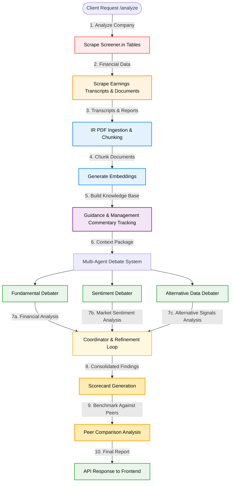


### Debate Logic (Summary)

1. Scrape structured data and ingest transcripts.
2. Run 3 debaters in parallel.
3. Coordinator refines low-confidence outputs and merges research points.
4. Scorecards are produced with dimensions, evidence, and confidence.
5. Peer comparison is added when multiple companies are requested.

### RAG Q&A Flow

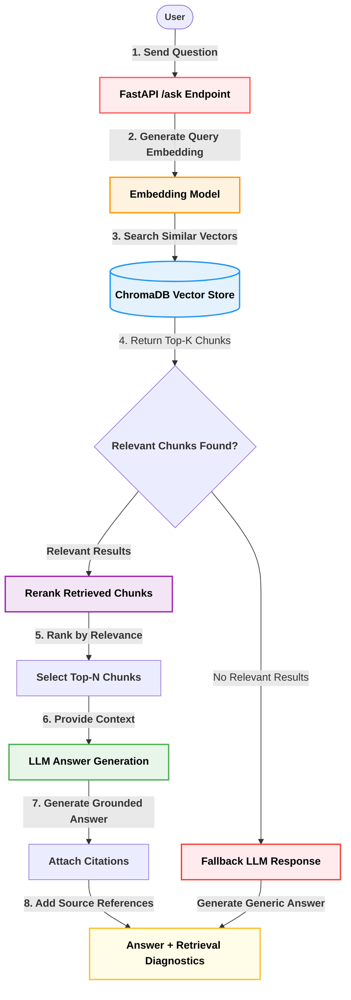

## Tech Stack & Dependencies

**Backend**
- Python, FastAPI, Pydantic
- SQLAlchemy + PostgreSQL
- ChromaDB + sentence-transformers embeddings
- Requests, BeautifulSoup, pdfplumber (document parsing)
- LLM providers: Grok + Gemini (configurable)

**Frontend**
- Vite, React, TypeScript
- Tailwind CSS + Radix UI + shadcn/ui
- TanStack React Query, Recharts, Lucide icons

**Data / Storage**
- PostgreSQL for structured metrics
- ChromaDB for semantic retrieval

## Prerequisites

- Python 3.10+
- Node.js 18+
- PostgreSQL (for structured metrics)
- API keys for Grok, Gemini, Exa, and Firecrawl

## Installation

1) Backend setup

```bash
python -m venv .venv
.venv\Scripts\activate
pip install -r backend/requirements.txt
```

2) Environment variables

Create a `.env` file in the project root (or export variables) with:

```bash
GROK_API_KEY=
GEMINI_API_KEY=
EXA_API_KEY=
FIRECRAWL_API_KEY=
LLAMA_CLOUD_API_KEY=
POSTGRES_URL=
CHROMA_PERSIST_DIR=./backend/chroma_data
DEBATER_MODEL=grok
COORDINATOR_MODEL=grok
QA_MODEL=gemini
EARNINGS_API_USER=
EARNINGS_API_PASS=
EARNINGS_API_BASE_URL=https://discountingcashflows.com/api/transcript
EARNINGS_CURRENT_YEAR=2024
```

3) Initialize the database

```bash
python backend/scripts/init_db.py
```

4) Frontend setup

```bash
cd frontend/insight-navigator
npm install
```

## Usage

### Run the backend

```bash
uvicorn backend.main:app --reload --port 8000
```

### Run the frontend

```bash
cd frontend/insight-navigator
npm run dev
```

### Example: Analyze a company

```bash
curl -X POST http://localhost:8000/analyze \
	-H "Content-Type: application/json" \
	-d '{
		"companies": [{
			"name": "Persistent Systems",
			"screener_id": "PERSISTENT",
			"sector": "Technology",
			"ir_page_url": "https://www.persistent.com/investors/"
		}],
		"quarters": 4,
		"debate_refinement_threshold": 0.7
	}'
```

### Example: Ask a question with citations

```bash
curl -X POST http://localhost:8000/ask \
	-H "Content-Type: application/json" \
	-d '{
		"question": "What is the company\'s ROCE trend in Q3 FY24?",
		"company": "Persistent Systems",
		"top_k": 8
	}'
```

## API Documentation

Base URL: `http://localhost:8000`

### GET /health
Returns service health status.

**Response**
```json
{ "status": "ok" }
```

### POST /analyze
Runs multi-agent analysis and returns scorecards and comparisons.

**Request**
```json
{
	"companies": [
		{
			"name": "Persistent Systems",
			"screener_id": "PERSISTENT",
			"ir_page_url": "https://www.persistent.com/investors/",
			"sector": "Technology"
		}
	],
	"quarters": 4,
	"debate_refinement_threshold": 0.7
}
```

**Response (shape)**
```json
{
	"scorecards": [
		{
			"company_name": "Persistent Systems",
			"dimensions": [
				{
					"dimension": "Industry Position",
					"score": 78.0,
					"max_score": 100.0,
					"confidence": 0.82,
					"evidence": "...",
					"source": "Fundamental Debater",
					"reasoning": [
						{ "agent": "Fundamental", "message": "Position: bullish", "timestamp": "...", "type": "position" }
					]
				}
			],
			"overall_score": 78.5,
			"confidence_score": 82.0,
			"timestamp": "...",
			"agents_participated": ["Fundamental Debater", "Sentiment Debater", "Alternative Debater"]
		}
	],
	"guidance_tracker": [],
	"peer_comparisons": [],
	"execution_status": "success",
	"error": null
}
```

### POST /ask
Answers a question using RAG with citations (or fallback QA if retrieval is empty).

**Request**
```json
{
	"question": "What is the revenue trend?",
	"company": "Persistent Systems",
	"top_k": 8
}
```

**Response (shape)**
```json
{
	"answer": "Revenue grew 18% YoY in Q3 FY24 [1].",
	"citations": [
		{ "document": "screener.in", "page": 3, "excerpt": "...", "source": "screener.in", "table_type": "quarterly_results", "index": 1 }
	],
	"retrieved_chunks": [],
	"retrieval_count": 1,
	"fallback_used": false,
	"error": null
}
```

## UI Screenshots

Screens are ordered by user flow through the product.

**Home / Discover**

<div align="center">
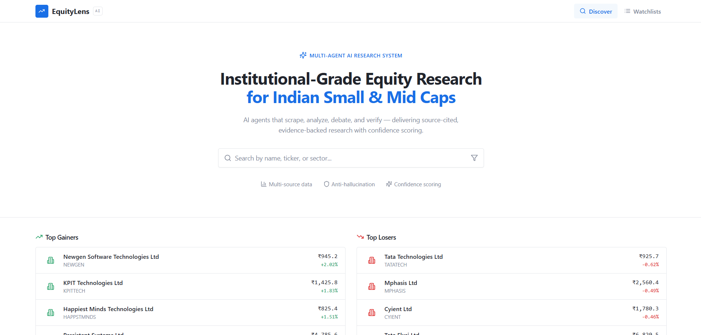
</div>

**Company Overview**

<div align="center">
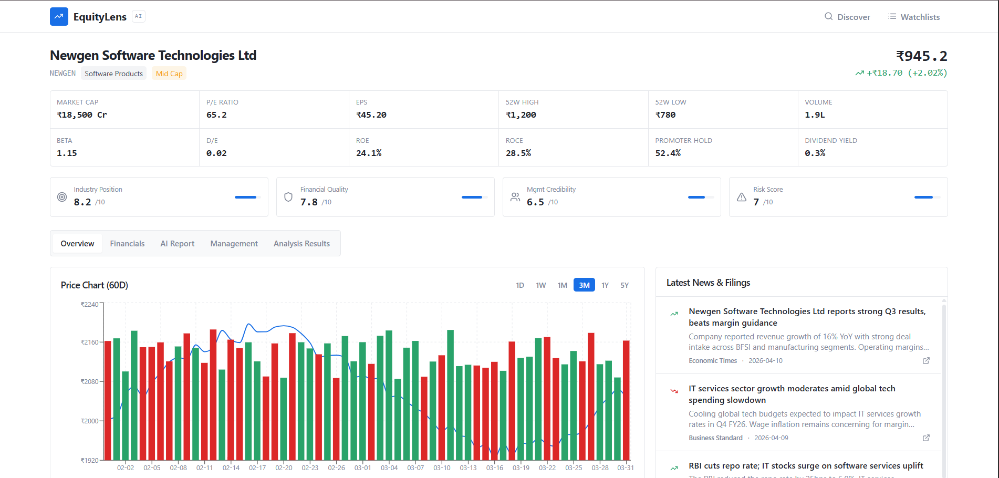
</div>

**Company Financials**

<div align="center">
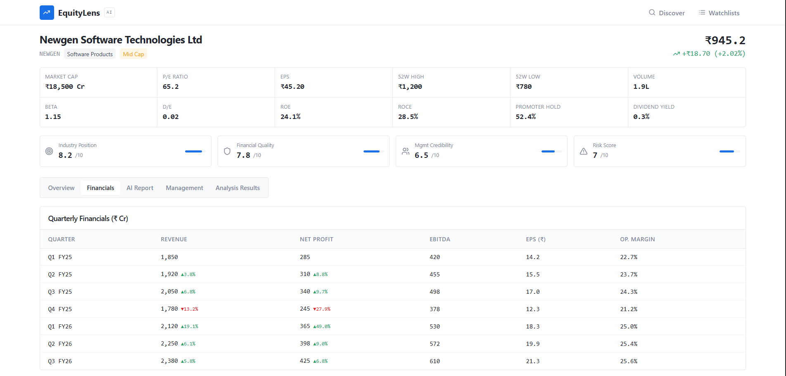
</div>

**AI Report**

<div align="center">
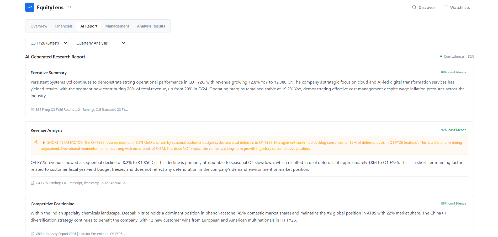
</div>

**Management Guidance**

<div align="center">
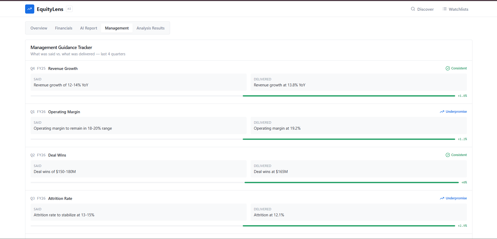
</div>

**Analysis Results**

<div align="center">
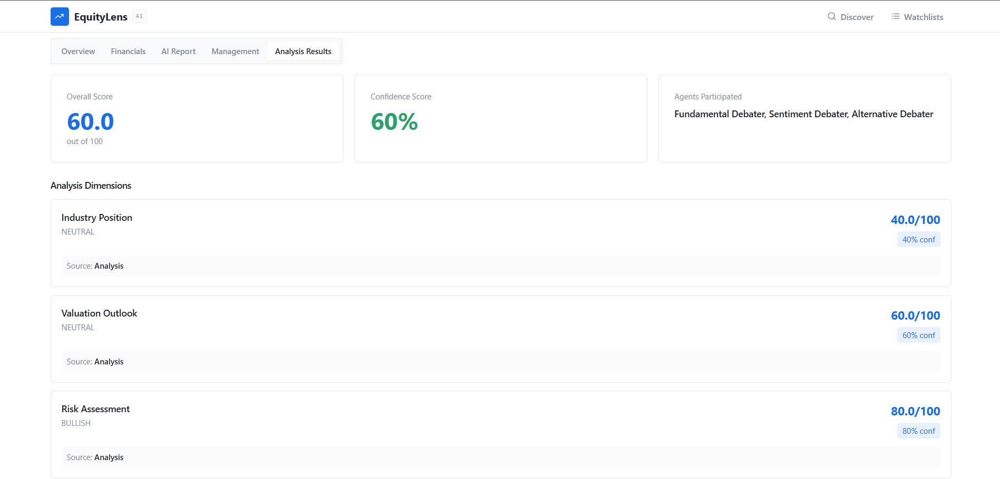
</div>

**Watchlists**

<div align="center">
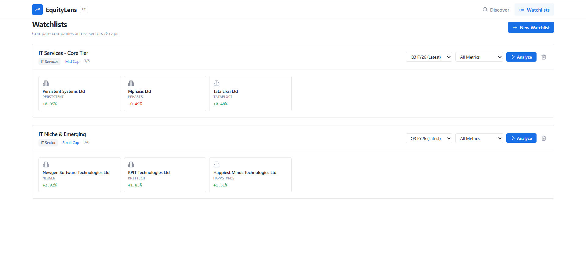
</div>

**Watchlist Analysis - Agents Running**

<div align="center">
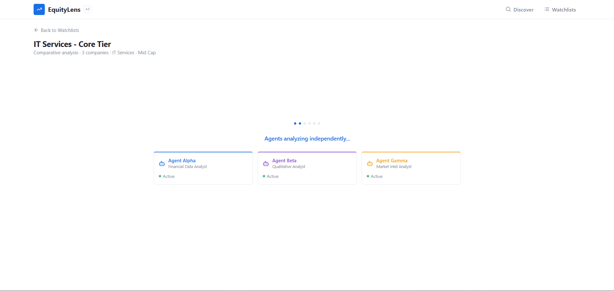
</div>

**Watchlist Analysis - Report Ready**

<div align="center">
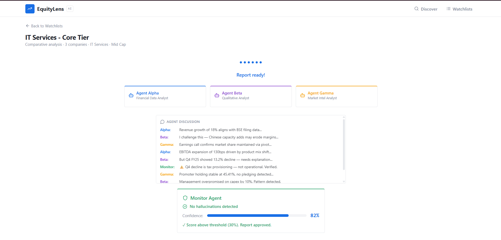
</div>

**Watchlist Analysis - Comparison Table**

<div align="center">
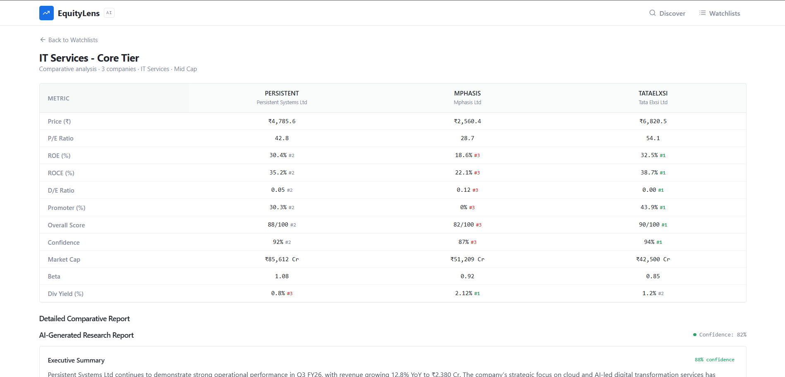
</div>

**Watchlist Analysis - Detailed Report**

<div align="center">
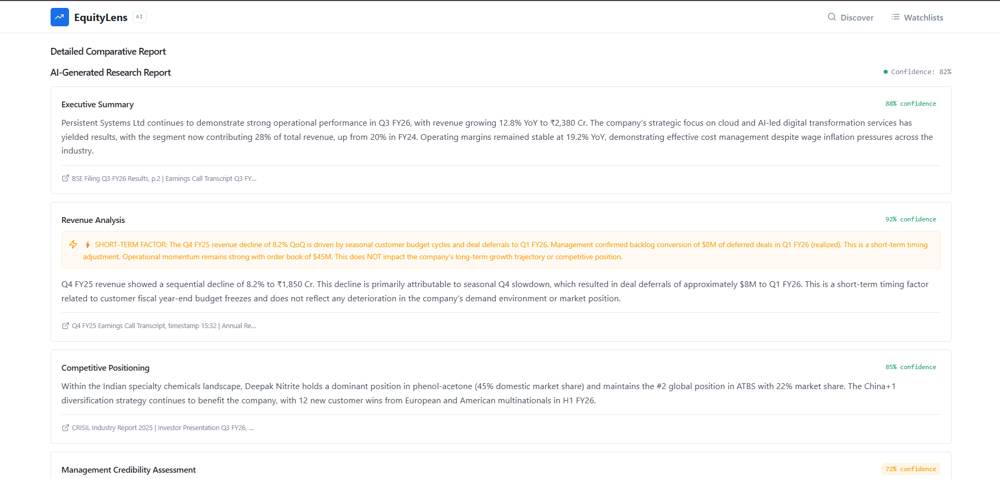
</div>

## Project Structure Overview

```
backend/
	agents/              # Debaters, coordinator, QA agent
	rag/                 # Retrieval + rerank + citation pipeline
	storage/             # PostgreSQL + ChromaDB adapters
	tools/               # Scraping, parsing, verification, embedding
	tests/               # API and schema tests
	main.py              # FastAPI app and endpoints
frontend/insight-navigator/
	src/
		pages/             # App routes (Index, CompanyDetail, Watchlists, Analysis)
		components/        # UI components
```

## Contribution Guide

See [CONTRIBUTION.md](CONTRIBUTION.md) for the full guide.

1. Fork the repo and create a feature branch.
2. Follow the existing patterns in backend agents and frontend components.
3. Add or update tests when changing API responses.
4. Open a PR with a clear summary and screenshots for UI changes.

## License

This project is licensed under the MIT License. See [LICENSE](LICENSE).
